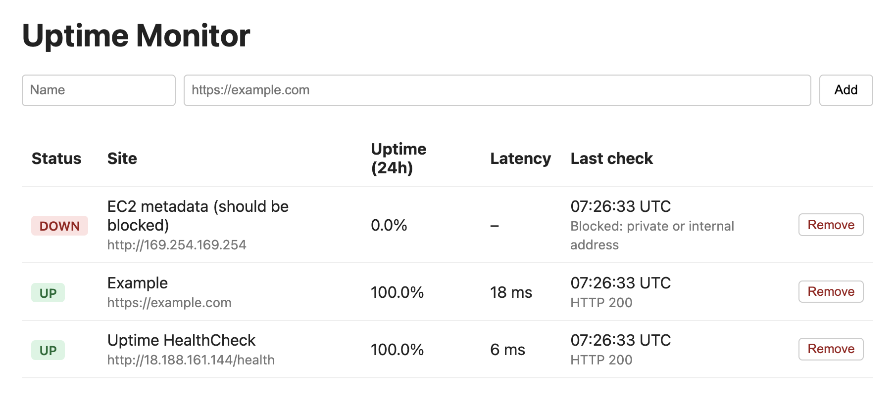
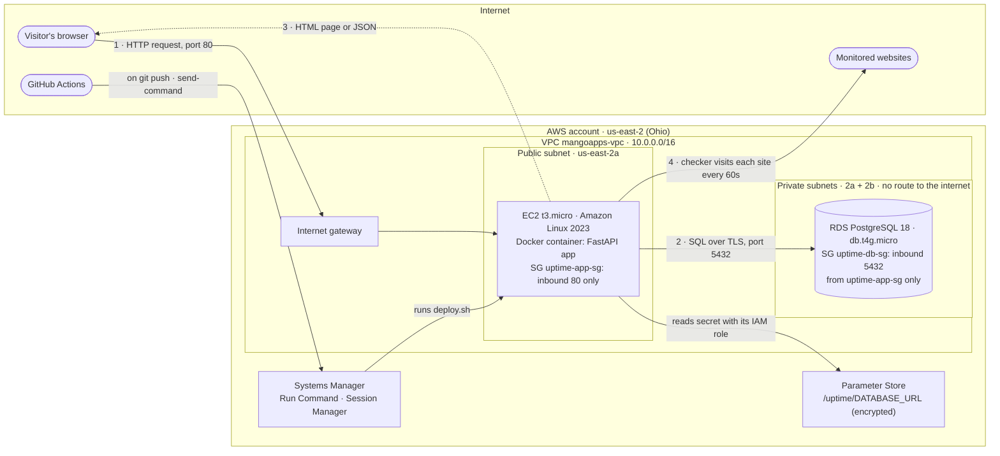

# Uptime Monitor on AWS

A small website uptime monitor, deployed on AWS. You add a site, and the app visits it every 60 seconds, saves each result in PostgreSQL, and shows whether it's up, how fast it answered and its uptime over the last 24 hours.

- **Live app:** http://18.188.161.144
- **Health check:** http://18.188.161.144/health

The app is deliberately simple. The focus is on how it's deployed and run: private networking, no open admin ports, no secrets in the repo, health-gated deploys and $0 cost.



---

## Architecture



The same diagram as an image: [docs/architecture.png](docs/architecture.png)

**How a request travels:**

1. The browser sends `GET /` to the instance's public IP. It enters the VPC through the internet gateway, and the security group lets it through because it's port 80.
2. Docker forwards port 80 to the app on port 8000. The app asks RDS for the latest check of every site, over an encrypted connection inside the VPC.
3. The app renders the HTML page and sends it back the same way. The database never talks to the internet; it has no public IP and its subnets have no internet route.

Separately, a background task in the app visits every monitored site once a minute and writes the results to RDS.

---

## Design choices

For each choice, the option I didn't pick and why.

| Area | Choice | Considered instead | Why |
|---|---|---|---|
| **Compute** | EC2 **t3.micro** | t4g.micro (ARM) | Free Tier eligible, 2 vCPUs, 1 GB RAM, plenty for one container. ARM would mean building images for a different CPU than my laptop, with no benefit at this size. |
| **Linux** | **Amazon Linux 2023** | Ubuntu 24.04 | It comes with the SSM agent, Docker is one `dnf install`, and AWS maintains it for EC2. Ubuntu would work, but it adds nothing here. |
| **Database** | **RDS PostgreSQL** in private subnets | DynamoDB; Postgres in a container on the EC2 instance | The data is relational (sites and their checks, joined for the status page), and I use Postgres locally too (16 in Compose; RDS runs 18, and the app's SQL works on both). DynamoDB would mean rewriting the queries. A container next to the app would put the data on the public-facing machine, with no automatic backups. |
| **Traffic** | Straight to the instance's public IP, port 80 | Application Load Balancer | A load balancer adds health-based routing and an easy path to HTTPS, but it isn't free. For one instance it would be extra cost and complexity. |
| **Admin access** | **SSM Session Manager** | SSH with port 22 limited to my IP | No open admin port, no key file to lose, and every session is logged. |
| **Secrets** | **SSM Parameter Store** (SecureString) | `.env` file on the server; Secrets Manager | The password is encrypted and never on disk or in Git. The server reads it with its IAM role. Secrets Manager costs $0.40/month for features I don't need, like automatic rotation. |
| **Deploy auth** | Dedicated IAM user, keys in GitHub Secrets | GitHub OIDC (no stored keys) | OIDC was my first choice. In this account, adding an identity provider requires upgrading the organization, which removes its spend limits. So I limited the deploy user to running one command on one instance (see [Security](#security)). |

**Extras I chose: Docker and CI/CD.** Docker makes the app run the same on my laptop and on EC2. CI/CD means every push to `main` is built, deployed and health-checked without me logging in to the server. Together they cover how code gets from a laptop to a running server, which is most of a DevOps engineer's daily work. I left out monitoring, HTTPS and infrastructure as code to keep the scope small, not because of cost: CloudWatch's free tier covers basic alarms, CloudFormation itself is free, and CloudFront can serve HTTPS on its own domain within its free tier. All three are on the [production list](#what-id-change-before-real-customers).

---

## Security

- **Only one inbound port.** The app's security group allows port 80 and nothing else. There's no SSH, so port 22 is closed.
- **Database is unreachable from the internet.** It sits in private subnets with no public IP. Its security group accepts port 5432 only from the app's security group and has no outbound rules. The app connects with `sslmode=require`.
- **Narrow outbound rules on the app.** The app can make connections only on port 80 and 443 (to check sites, pull images and reach AWS APIs) and on 5432 to the database group.
- **No secrets in the repo or the image.** The database URL lives in Parameter Store. `deploy.sh` passes it to the container from memory, so it never appears in files or the process list. `.env` is gitignored.
- **The deploy user can do one thing:** run a command on this one instance (`ssm:SendCommand` on its ARN and the `AWS-RunShellScript` document), plus read the result. It has no console access.
- **IMDSv2 only** on the instance. The container runs as a non-root user.
- **SSRF guard.** Users submit URLs, so the checker refuses to visit private or internal addresses, such as `10.x` or the EC2 metadata service `169.254.169.254`. It doesn't follow redirects, since a redirect could point somewhere internal. The page caps the number of sites at 20.
- **No root.** All work runs through IAM identities, not the account root user.

## Cost

Everything runs inside the AWS Free Tier: **$0**.

| Resource | Free Tier |
|---|---|
| EC2 t3.micro, 8 GB gp3 | 750 hours/month |
| RDS db.t4g.micro, 20 GB, single-AZ, encrypted, 1-day backups | 750 hours/month |
| Parameter Store (standard), Systems Manager | free |
| Public IPv4 address | covered by Free Tier / credits |

Decisions that keep it at $0: **no NAT gateway** (about $32/month; the database doesn't need internet access), no load balancer, no Elastic IP, Performance Insights and storage autoscaling off, Secrets Manager not used. A **zero-spend budget** emails me if anything starts to cost money.

---

## Run it locally

Requires Docker.

```bash
cp .env.example .env          # set your own local POSTGRES_PASSWORD
docker compose up --build
```

Open http://localhost:8000. Compose starts the app and its own Postgres. The database has no published port, so only the app can reach it.

## How it's deployed

### One-time AWS setup (console)

1. **VPC** `mangoapps-vpc`: 2 public and 2 private subnets in two Availability Zones, no NAT gateway.
2. **Security groups:**
   - `uptime-app-sg`: inbound 80 from anywhere. Outbound 80 and 443 to anywhere, and 5432 to `uptime-db-sg`.
   - `uptime-db-sg`: inbound 5432 from `uptime-app-sg`, no outbound rules.
3. **RDS:** subnet group with the two private subnets; PostgreSQL 18, `db.t4g.micro`, public access off, database `uptime`.
4. **Parameter Store:** `/uptime/DATABASE_URL` as a SecureString:
   `postgresql://uptime:<password>@<rds-endpoint>:5432/uptime?sslmode=require`
5. **IAM role** `uptime-ec2-role` with `AmazonSSMManagedInstanceCore`, for Session Manager and Parameter Store.
6. **EC2:** Amazon Linux 2023, `t3.micro`, public subnet, `uptime-app-sg`, the role above, IMDSv2 only, no key pair. User data installs Docker and Git:
   ```bash
   #!/bin/bash
   dnf install -y docker git
   systemctl enable --now docker
   ```

### Deploying

[`deploy/deploy.sh`](deploy/deploy.sh) does the whole deploy on the instance:

1. waits for first-boot setup to finish
2. pulls the latest `main`
3. builds the image, tagged with the commit
4. reads the database URL from Parameter Store
5. replaces the container (port 80 → 8000, restart on failure, log rotation)
6. waits for `/health` to return OK. If it doesn't, it **rolls back to the previous image** and fails.

First deploy, from a Session Manager shell on the instance:

```bash
sudo git clone https://github.com/spandey1702/uptime-monitor-aws.git /opt/uptime
sudo /opt/uptime/deploy/deploy.sh
```

### CI/CD

[`.github/workflows/deploy.yml`](.github/workflows/deploy.yml) runs on every push to `main`:

1. **build:** `docker build` on GitHub's runner, so a broken build fails before it reaches the server.
2. **deploy:** runs `deploy.sh` on the instance through SSM Run Command and prints its output.
3. **health:** calls `/health` from outside AWS, the way a visitor would.

It needs these repository settings:

| Type | Name | Value |
|---|---|---|
| Secret | `AWS_ACCESS_KEY_ID`, `AWS_SECRET_ACCESS_KEY` | keys of the `github-deploy` IAM user |
| Variable | `EC2_INSTANCE_ID` | the instance ID |
| Variable | `APP_URL` | `http://18.188.161.144` |

## Health check

`GET /health` returns **200** when the app can reach the database (a `SELECT 1` within 2 seconds) and the background checker has completed a round recently. Otherwise it returns **503**. Error details go only to the logs, never into the public response.

```json
{"status":"ok","database":"ok","checker":"ok","last_check_round_seconds_ago":12}
```

Docker uses the same endpoint for its `HEALTHCHECK`, and CI/CD uses it to accept or reject a deploy.

---

## What went wrong, and how I found the cause

- **The RDS status showed no database name.** After creation, `describe-db-instances` showed `DBName: None`. I'd missed "Initial database name", which is hidden under Additional configuration and can't be set after creation. Instead of rebuilding RDS, I connected from EC2 with a throwaway `postgres` container and ran `CREATE DATABASE uptime`. That also proved the EC2 → RDS path through both security groups and TLS.
- **Docker wasn't running on the new instance.** `docker run` said it couldn't connect to the daemon. `systemctl status` showed Docker had started at the exact second cloud-init finished, so I had connected while user data was still installing packages. `deploy.sh` now waits with `cloud-init status --wait`.
- **The first CI/CD run failed on the health check.** The deploy step had passed, but `curl` rejected the URL as malformed. The log showed the URL broken across two lines: the `APP_URL` variable had a pasted newline. The workflow now strips whitespace from it and prints the exact URL it checks.
- **Locally, the app wouldn't start: "Address already in use".** `lsof -iTCP:8000 -sTCP:LISTEN` showed Anaconda Navigator holding port 8000, not an old copy of the app.

## What I'd change before real customers

- **HTTPS:** CloudFront in front of the instance (HTTPS on its own domain, within the free tier), or a custom domain with an ACM certificate on a load balancer.
- **High availability:** an Auto Scaling group across two Availability Zones behind the load balancer, and Multi-AZ RDS. The checker would move to its own worker, so it doesn't run twice.
- **OIDC for CI/CD** instead of stored keys, and a GitHub environment restricted to `main`.
- **Infrastructure as code** (CloudFormation or Terraform), so the whole setup can be reviewed and rebuilt.
- **Monitoring:** CloudWatch alarms on `/health`, CPU and RDS storage; logs shipped to CloudWatch Logs.
- **Images in ECR**, built once in CI, instead of building on the instance.
- **Tighter IAM:** the instance role limited to reading `/uptime/*` instead of the managed policy's broader Parameter Store access.
- **App features:** user accounts, so one visitor can't remove another's sites; alerts when a site goes down.

## Repository layout

```
app/                    FastAPI app (main.py, db.py, checker.py, schema.sql, templates/)
app/Dockerfile          Python 3.12 slim image, non-root user, HEALTHCHECK on /health
docker-compose.yml      local development: app + Postgres
deploy/deploy.sh        build, run and health-check on EC2, with rollback
.github/workflows/      CI/CD: build → deploy through SSM → health check
```

## Shutting it down

After review: terminate the EC2 instance, delete the RDS instance (skip the final snapshot), then delete the Parameter Store entry, the VPC, the security groups and the `github-deploy` user.
